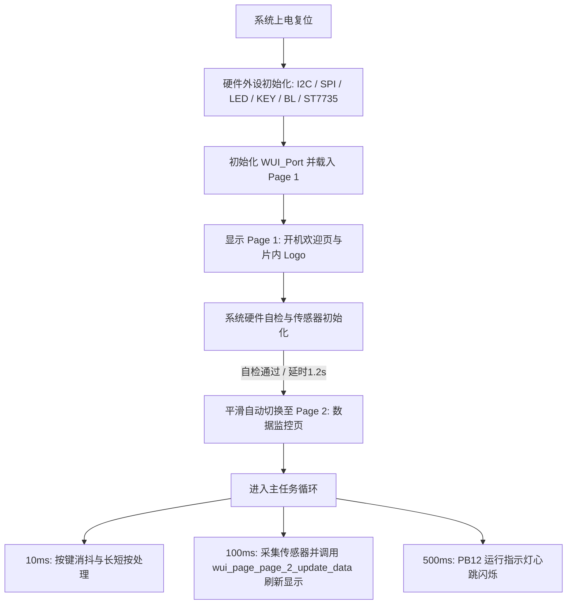

# CH32X035F8U6 传感器与 WCHGUI 屏幕监控系统

本项目基于沁恒 RISC-V 微控制器 **CH32X035F8U6**（亮度采集板 V1.0），使用 **MounRiver Studio Ⅱ** 框架构建。系统实现了环境光照强度采集、三轴加速度与姿态角解算、0.96 寸彩色 TFT 屏高帧率显示、屏幕背光 PWM 调光、用户按键交互及系统心跳指示。

图形界面完全由 **WCHGUIDesigner** 官方可视化设计器生成，工程源码直接引用并驱动 `WCHGUIProject/generated/wui_user/` 目录中的 UI 驱动代码，实现了底层驱动、GUI 框架、用户业务逻辑的三层彻底解耦。

---

## 1. 硬件引脚资源映射表

| 芯片引脚 | 网络标号 | 对应功能模块 | 硬件电路特性与驱动方式 |
| :--- | :--- | :--- | :--- |
| **Pin 1** | `VDD` | 3.3V 主电源 | ME6211C33M5G-N LDO 供电 |
| **Pin 2** | `PA0` (INT1) | 姿态传感器中断 1 | LIS2DW12TR `INT1`，板载 10kΩ 上拉电阻 (R10) |
| **Pin 3** | `PA1` (INT2) | 亮度传感器中断 | LTR-308ALS-01 `INT`，板载 10kΩ 上拉电阻 (R11) |
| **Pin 4** | `PA2` (K1) | 用户按键 SW2 | 板载 10kΩ 上拉电阻 (R13) + 100nF 滤波电容 (C10)，按下为低电平 |
| **Pin 5** | `PA3` (BL) | TFT 屏幕背光调节 | 驱动 DTC143ZE (U5) 偏置三极管控制 LEDK；支持 **TIM2_CH4 PWM 调光** / GPIO |
| **Pin 6** | `PA4` (TRES) | TFT 屏幕复位 (Reset) | 通用推挽输出 (GPIO_Mode_Out_PP)，低电平复位 |
| **Pin 7** | `PA5` (TSCL) | TFT 屏幕 SPI 时钟 (SCL) | **硬件 SPI1_SCK** 复用推挽输出 (36MHz 高速传输) |
| **Pin 8** | `PA6` (TRS) | TFT 屏幕 数据/命令选择 (DC) | 通用推挽输出 (GPIO_Mode_Out_PP)，高电平数据，低电平命令 |
| **Pin 9** | `PA7` (TSDA) | TFT 屏幕 SPI 数据 (MOSI) | **硬件 SPI1_MOSI** 复用推挽输出 (36MHz 高速传输) |
| **Pin 10** | `PB0` (SDA) | I2C 总线数据线 (SDA) | 连接 LTR-308 与 LIS2DW12，板载 4.7kΩ 上拉 (R7)，模拟开漏时序 |
| **Pin 11** | `PB1` (SCL) | I2C 总线时钟线 (SCL) | 连接 LTR-308 与 LIS2DW12，板载 4.7kΩ 上拉 (R6)，推挽输出时钟 |
| **Pin 12** | `PB3` | 未使用 | 悬空引脚 |
| **Pin 13** | `PB11` | 未使用 | 悬空引脚 |
| **Pin 14** | `PC18` (DIO) | 调试接口 SWDIO | 连接 Type-C SBU1，用于 WCH-Link 烧录与仿真 |
| **Pin 15** | `PB12` (RUN) | 运行状态指示灯 LED1 | 阳极经 1kΩ (R3) 接 3.3V，阴极接 PB12；**低电平点亮**，心跳指示 |
| **Pin 16** | `PC19` (DCK) | 调试接口 SWCLK | 连接 Type-C SBU2，用于 WCH-Link 烧录与仿真 |
| **Pin 17** | `PC16` (UDM) | USB 2.0 数据 D- | 连接 Type-C USB DM（带 USBLC6-2SC6 ESD 保护） |
| **Pin 18** | `PC17` (UDP) | USB 2.0 数据 D+ / Boot 按键 | 经 1kΩ (R12) 接 3.3V 并连接 SW1 按键；**按下接高电平 (拉高)**，进入芯片内置 Bootloader 烧录模式 |
| **Pin 19** | `PC14` (CC1) | Type-C 配置通道 1 | 5.1kΩ 下拉至地 |
| **Pin 20** | `PC15` (CC2) | Type-C 配置通道 2 | 5.1kΩ 下拉至地 |
| **Pin 21** | `GND` | 芯片底部接地焊盘 (EP) | 参考地 |
| **—** | `CS` | TFT 屏幕片选 | **硬件固定接地 (GND)**，始终选通使能，无需占用额外引脚 |

---

## 2. 软件工程目录架构

```text
CH32X035F8U/
├── Driver/                                     # 通信总线抽象层 (硬件接口解耦)
│   ├── soft_i2c.h / soft_i2c.c                 # 模拟 I2C 驱动 (PB0-SDA, PB1-SCL)，标准开漏时序
│   └── spi_driver.h / spi_driver.c             # 硬件 SPI1 驱动 (PA5-SCK, PA7-MOSI)，36MHz 高速传输
├── Bsp/                                        # 板级支持包与器件驱动层 (零 UI 残留)
│   ├── bsp_led.h / bsp_led.c                   # LED1 运行指示灯 (PB12，心跳控制)
│   ├── bsp_key.h / bsp_key.c                   # 用户按键 SW2 (PA2，非阻塞消抖与长短按识别)
│   ├── bsp_backlight.h / .c                    # 背光驱动 (PA3，TIM2_CH4 PWM 调光与开关)
│   ├── ltr308.h / ltr308.c                     # LTR-308ALS-01 环境光照度传感器驱动 (I2C: 0x53)
│   ├── lis2dw12.h / lis2dw12.c                 # LIS2DW12TR 三轴加速度传感器驱动 (I2C: 0x19)
│   └── st7735.h / st7735.c                     # 0.96寸 ST7735S 底层驱动 (80x160 偏移校准与窗口绘制)
├── App/                                        # 业务逻辑与算法层
│   └── app_sensor.h / app_sensor.c             # 传感器数据融合采样与俯仰/横滚姿态角解算
├── wui/                                        # WCH 官方 WCHGUI 运行时核心库
│   ├── libwui_0.2.a                            # WCHGUI 静态库 (RV32IMAC 架构)
│   ├── wui.h                                   # WCHGUI 核心 API 与数据类型
│   └── wui_widget.h                            # WCHGUI 控件系统与属性结构体
├── wui_port/                                   # WCHGUI 硬件抽象移植层 (HAL)
│   ├── wui_port.h / wui_port.c                 # 对接 ST7735S 窗口设置、SPI传输、片内Flash图像加载与堆内存管理
│   ├── LCD.h                                   # 屏幕分辨率 (160x80) 与色彩宏定义
│   └── LCD_Font.h / LCD_Font.c                 # 点阵字模库 (6x12, 8x16)
├── WCHGUIProject/                              # WCHGUIDesigner 可视化设计器工程
│   ├── project.wuiproj.json                    # 设计器工程元数据 (160x80)
│   └── generated/wui_user/                     # ★ 设计器生成的代码目录 (工程直接引用)
│       ├── wui_page.h / wui_page.c             # 页面注册与切换控制器
│       ├── wui_page_none.h / .c                # 空页面定义
│       ├── wui_page_page_1.h / .c              # Page 1: 系统初始化/开机欢迎页 (含 Logo 与标题)
│       ├── wui_page_page_2.h / .c              # Page 2: 数据监控页 (光强、姿态、X/Y/Z、背光控件驱动)
│       ├── wui_asset.h / wui_asset.c           # 字符串与静态资源映射
│       ├── images.h / images.bin               # 图像元数据与二进制数据
│       └── wui_internal_data.h                 # 片内 Flash 存储的图片字模二进制数组
├── User/                                       # 系统主程序入口
│   ├── main.c                                  # 系统主循环、页面调度与数据流推送
│   ├── ch32x035_it.c / .h                      # 中断服务函数
│   └── ch32x035_conf.h                         # 固件库头文件配置
└── README.md                                   # 项目文档与技术规格书
```

---

## 3. UI 架构与页面流转机制

### 3.1 页面切换逻辑


### 3.2 Page 2 控件与数据映射说明
在 `WCHGUIProject/generated/wui_user/wui_page_page_2.h` 与 `.c` 中，定义了数据驱动接口：
```c
void wui_page_page_2_update_data(float lux, float pitch, float roll, float ax, float ay, float az, uint8_t bl_percent);
```
控件 ID 与显示内容绑定关系如下：
- **`PAGE_2_COMPONENT_001`**：环境光照强度（`光强: xxxx`），单位 Lux。
- **`PAGE_2_COMPONENT_002`**：姿态角度（`姿态:P:xx R:xx`），实时显示俯仰角与横滚角（度）。
- **`PAGE_2_COMPONENT_003`**：X 轴加速度（`X: xxx`），单位 mg。
- **`PAGE_2_COMPONENT_004`**：Y 轴加速度（`Y: xxx`），单位 mg。
- **`PAGE_2_COMPONENT_005`**：Z 轴加速度（`Z: xxx`），单位 mg。
- **`PAGE_2_COMPONENT_006`**：屏幕背光占空比（`亮度: xxx%`）。

---

## 4. 各核心功能模块技术细节

### 4.1 亮度传感器：LTR-308ALS-01
- **接口**：模拟 I2C，从机地址 `0x53`。
- **配置**：3X 增益，100ms 积分时间，软件复位与 `PART_ID` 自检校验。
- **换算**：自动将 20-bit 原生通道计数值换算为标准物理单位 Lux。

### 4.2 姿态传感器：LIS2DW12TR
- **接口**：模拟 I2C，从机地址 `0x19`。
- **配置**：14-bit 高性能模式，±2g 量程，灵敏度 0.244 mg/LSB，启用 BDU（块数据更新防撕裂）。
- **姿态解算**：基于重力分量三角函数实时解算 Pitch / Roll 角。

### 4.3 0.96 寸彩色 TFT 屏：ST7735S 与 WCHGUI 移植
- **接口**：硬件 SPI1（PA5: SCK, PA7: MOSI），36MHz 传输主频。
- **坐标修正**：横屏模式（160×80），Offset 校准为 $X=1, Y=26$。
- **HAL 移植**：`wui_port.c` 实现了标准 `wui_hal_t`，通过 `memcpy` 直接从片内 Flash 数组 `wui_internal_data` 读取开机图片，由 WCHGUI 静态库驱动无闪烁渲染。

### 4.4 背光调节与按键交互
- **背光控制**：PA3 由 TIM2_CH4 输出 10kHz PWM，支持 0%~100% 占空比。
- **用户按键 (PA2)**：
  - **单击**：循环切换背光档位（`100% -> 75% -> 50% -> 25% -> 10% -> 100%`），界面实时同步显示亮度百分比。
  - **长按**（>600ms）：关断背光进入节能状态 / 再次长按恢复背光。
- **心跳指示 (PB12)**：主循环以 500ms 周期翻转低电平驱动 LED1。

### 4.5 Type-C 接口双模运行机制 (USB ISP 烧录 vs USB CDC 虚拟串口调试)
板载 Type-C 接口连接至 MCU 的 PC16 (UDM) 与 PC17 (UDP)，通过硬件上电检测实现免额外转接模块的双模智能复用：
1. **USB 烧录模式 (ROM Bootloader)**：
   - 按住板载按键 **SW1** 插入 Type-C 线或复位，硬件将 PC17 经 R12(1kΩ) 接 3.3V 拉高；
   - 芯片自动进入出厂固化的 Bootloader，电脑识别为 **WCH USB ISP 设备**，使用 WCHISPTool 极速下载固件。
2. **USB CDC 虚拟串口调试模式 (User App)**：
   - 正常开机启动（松开 SW1），MCU 直接执行用户固件；
   - 固件自动将 USBFS 外设初始化为 **USB CDC-ACM 设备**（全速 12Mbps），Windows 10/11 系统免驱自动枚举为 `USB 串行设备 (COMx)`；
   - 底层 `printf` 已重定向至 USB CDC 环形发送队列，打开串口助手（115200 8N1）即可实时接收传感器结构化调试日志；
   - **非阻塞无感设计**：未插电脑或串口未打开时，发送函数直接非阻塞跳过，不影响屏幕刷新与系统流畅度。

---

## 5. 编译与固件产物

### 5.1 命令行编译
已配置标准 GCC 与 Make 构建系统，可直接在 `obj/` 目录执行：
```powershell
make clean
make all
```

### 5.2 资源占用情况 (RISC-V GCC rv32imacxw -Os)
```text
   text    data     bss     dec     hex filename
  39848     328    7484   47660    ba2c CH32X035F8U.elf
```
- **Flash (Text + Data)**：**40.17 KB** / 62 KB (占用率约 **64.7%**)
- **SRAM (Data + BSS)**：**7.81 KB** / 20 KB (占用率约 **39.0%**，包含 WCHGUI 3KB 独立运行堆区与 USB CDC 缓冲区)
- 生成固件位于：
  - `obj/CH32X035F8U.elf`
  - `obj/CH32X035F8U.hex`
