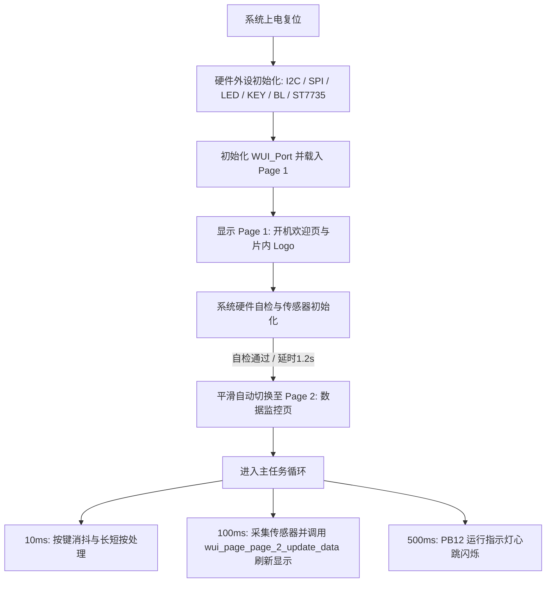

# CH32X035F8U6 传感器与 WCHGUI 屏幕监控系统

本项目基于沁恒 RISC-V 微控制器 **CH32X035F8U6**（亮度采集板 V1.0），使用 **MounRiver Studio Ⅱ** 框架构建。系统实现了环境光照强度采集、三轴加速度与姿态角解算、0.96 寸彩色 TFT 屏高帧率显示、屏幕背光 PWM 调光、用户按键交互及系统心跳指示。

图形界面完全由 **WCHGUIDesigner** 官方可视化设计器生成，工程源码直接引用并驱动 `WCHGUIProject/generated/wui_user/` 目录中的 UI 驱动代码，实现了底层驱动、GUI 框架、用户业务逻辑的三层彻底解耦。

---

## 1. 硬件引脚资源映射表

| 芯片引脚 | 网络标号 | 对应功能模块 | 硬件电路特性与驱动方式 |
| :--- | :--- | :--- | :--- |
| **Pin 1** | `VDD` | 3.3V 主电源 | ME6211C33M5G-N LDO 供电 |
| **Pin 2** | `PA0` (INT1) | 姿态传感器中断 1 | LIS2DW12TR `INT1`，板载 10kΩ 上拉电阻 (R10) |
| **Pin 3** | `PA1` (INT2) | 亮度传感器中断 | LTR-308ALS-01 `INT`，板载 10kΩ 上拉电阻 (R11) |
| **Pin 4** | `PA2` (K1) | 用户按键 SW2 | 板载 10kΩ 上拉电阻 (R13) + 100nF 滤波电容 (C10)，按下为低电平 |
| **Pin 5** | `PA3` (BL) | TFT 屏幕背光调节 | 驱动 DTC143ZE (U5) 偏置三极管控制 LEDK；支持 **TIM2_CH4 PWM 调光** / GPIO |
| **Pin 6** | `PA4` (TRES) | TFT 屏幕复位 (Reset) | 通用推挽输出 (GPIO_Mode_Out_PP)，低电平复位 |
| **Pin 7** | `PA5` (TSCL) | TFT 屏幕 SPI 时钟 (SCL) | **硬件 SPI1_SCK** 复用推挽输出 (36MHz 高速传输) |
| **Pin 8** | `PA6` (TRS) | TFT 屏幕 数据/命令选择 (DC) | 通用推挽输出 (GPIO_Mode_Out_PP)，高电平数据，低电平命令 |
| **Pin 9** | `PA7` (TSDA) | TFT 屏幕 SPI 数据 (MOSI) | **硬件 SPI1_MOSI** 复用推挽输出 (36MHz 高速传输) |
| **Pin 10** | `PB0` (SDA) | I2C 总线数据线 (SDA) | 连接 LTR-308 与 LIS2DW12，板载 4.7kΩ 上拉 (R7)，模拟开漏时序 |
| **Pin 11** | `PB1` (SCL) | I2C 总线时钟线 (SCL) | 连接 LTR-308 与 LIS2DW12，板载 4.7kΩ 上拉 (R6)，推挽输出时钟 |
| **Pin 12** | `PB3` | 未使用 | 悬空引脚 |
| **Pin 13** | `PB11` | 未使用 | 悬空引脚 |
| **Pin 14** | `PC18` (DIO) | 调试接口 SWDIO | 连接 Type-C SBU1，用于 WCH-Link 烧录与仿真 |
| **Pin 15** | `PB12` (RUN) | 运行状态指示灯 LED1 | 阳极经 1kΩ (R3) 接 3.3V，阴极接 PB12；**低电平点亮**，心跳指示 |
| **Pin 16** | `PC19` (DCK) | 调试接口 SWCLK | 连接 Type-C SBU2，用于 WCH-Link 烧录与仿真 |
| **Pin 17** | `PC16` (UDM) | USB 2.0 数据 D- | 连接 Type-C USB DM（带 USBLC6-2SC6 ESD 保护） |
| **Pin 18** | `PC17` (UDP) | USB 2.0 数据 D+ / Boot 按键 | 经 1kΩ (R12) 接 3.3V 并连接 SW1 按键；**按下接高电平 (拉高)**，进入芯片内置 Bootloader 烧录模式 |
| **Pin 19** | `PC14` (CC1) | Type-C 配置通道 1 | 5.1kΩ 下拉至地 |
| **Pin 20** | `PC15` (CC2) | Type-C 配置通道 2 | 5.1kΩ 下拉至地 |
| **Pin 21** | `GND` | 芯片底部接地焊盘 (EP) | 参考地 |
| **—** | `CS` | TFT 屏幕片选 | **硬件固定接地 (GND)**，始终选通使能，无需占用额外引脚 |

---

## 2. 软件工程目录架构

```text
CH32X035F8U/
├── App/                                        # 应用层与系统入口 (业务逻辑收拢)
│   ├── main.c                                  # 系统主循环、任务调度与页面数据流推送
│   ├── app_sensor.h / app_sensor.c             # 传感器数据融合采样、中断统计与俯仰/横滚姿态角解算
│   ├── ch32x035_it.h / ch32x035_it.c           # 中断服务函数 (EXTI 中断、系统嘀嗒等)
│   ├── system_ch32x035.h / system_ch32x035.c   # 芯片系统时钟初始化配置 (48MHz 主频)
│   └── ch32x035_conf.h                         # 固件库外设头文件使能配置
├── Hardware/                                   # 硬件驱动层 (传感器/屏幕/外设总线/USB-CDC 收拢)
│   ├── soft_i2c.h / soft_i2c.c                 # 模拟 I2C 驱动 (PB0-SDA, PB1-SCL)，标准开漏时序与超时检测
│   ├── spi_driver.h / spi_driver.c             # 硬件 SPI1 驱动 (PA5-SCK, PA7-MOSI)，36MHz 高速传输
│   ├── usb_cdc.h / usb_cdc.c                   # USB-CDC 虚拟串口驱动 (PC16-DM, PC17-DP 启动后重映射为调试串口)
│   ├── lis2dw12.h / lis2dw12.c                 # LIS2DW12TR 三轴加速度计驱动 (I2C: 0x19, 14-bit 高性能, INT1 使能)
│   ├── ltr308.h / ltr308.c                     # LTR-308ALS-01 环境光传感器驱动 (I2C: 0x53, 3X增益, INT2 使能)
│   ├── st7735.h / st7735.c                     # 0.96寸 ST7735S 屏幕底层驱动 (80x160 偏移校准与窗口绘制)
│   ├── bsp_int.h / bsp_int.c                   # 外部中断检测 (PA0-INT1 LIS2DW12, PA1-INT2 LTR308, EXTI7_0)
│   ├── bsp_led.h / bsp_led.c                   # LED1 运行指示灯 (PB12，心跳控制)
│   ├── bsp_key.h / bsp_key.c                   # 用户按键 SW2 (PA2，非阻塞消抖与长短按识别)
│   └── bsp_backlight.h / bsp_backlight.c       # 背光驱动 (PA3，TIM2_CH4 PWM 调光与开关)
├── Core/                                       # WCH 官方 RISC-V QingKe 内核支持库
├── Peripheral/                                 # WCH 官方标准外设固件库 (GPIO, TIM, SPI, USB 等)
├── Startup/ & Ld/                              # 启动汇编 (startup_ch32x035.S) 与链接脚本 (Link.ld)
├── Debug/                                      # WCH 官方调试串口底层支持库
├── wui/                                        # WCH 官方 WCHGUI 运行时核心库 (libwui_0.2.a)
├── wui_port/                                   # WCHGUI 硬件抽象移植层 (对齐 ST7735S、DMA、字体、内存池)
├── WCHGUIProject/                              # WCHGUIDesigner 可视化设计器工程与生成代码 (wui_user/)
├── obj/                                        # MounRiver 编译输出目录
└── README.md                                   # 项目文档与技术规格书
```

---

## 3. UI 架构与页面流转机制

### 3.1 页面切换逻辑


### 3.2 Page 2 控件与数据映射说明
在 `WCHGUIProject/generated/wui_user/wui_page_page_2.h` 与 `.c` 中，定义了数据驱动接口：
```c
void wui_page_page_2_update_data(float lux, float pitch, float roll, float ax, float ay, float az, uint8_t bl_percent);
```
控件 ID 与显示内容绑定关系如下：
- **`PAGE_2_COMPONENT_001`**：环境光照强度（`光强: xxxx`），单位 Lux。
- **`PAGE_2_COMPONENT_002`**：姿态角度（`姿态:P:xx R:xx`），实时显示俯仰角与横滚角（度）。
- **`PAGE_2_COMPONENT_003`**：X 轴加速度（`X: xxx`），单位 mg。
- **`PAGE_2_COMPONENT_004`**：Y 轴加速度（`Y: xxx`），单位 mg。
- **`PAGE_2_COMPONENT_005`**：Z 轴加速度（`Z: xxx`），单位 mg。
- **`PAGE_2_COMPONENT_006`**：屏幕背光占空比（`亮度: xxx%`）。

---

## 4. 各核心功能模块技术细节

### 4.1 亮度传感器：LTR-308ALS-01
- **接口**：模拟 I2C，从机地址 `0x53`。
- **配置**：3X 增益，100ms 积分时间，软件复位与 `PART_ID` 自检校验。
- **换算**：自动将 20-bit 原生通道计数值换算为标准物理单位 Lux。

### 4.2 姿态传感器：LIS2DW12TR
- **接口**：模拟 I2C，从机地址 `0x19`。
- **配置**：14-bit 高性能模式，±2g 量程，灵敏度 0.244 mg/LSB，启用 BDU（块数据更新防撕裂）。
- **姿态解算**：基于重力分量三角函数实时解算 Pitch / Roll 角。

### 4.3 0.96 寸彩色 TFT 屏：ST7735S 与 WCHGUI 移植
- **接口**：硬件 SPI1（PA5: SCK, PA7: MOSI），36MHz 传输主频。
- **坐标修正**：横屏模式（160×80），Offset 校准为 $X=1, Y=26$。
- **HAL 移植**：`wui_port.c` 实现了标准 `wui_hal_t`，通过 `memcpy` 直接从片内 Flash 数组 `wui_internal_data` 读取开机图片，由 WCHGUI 静态库驱动无闪烁渲染。

### 4.4 背光调节与按键交互
- **背光控制**：PA3 由 TIM2_CH4 输出 10kHz PWM，支持 0%~100% 占空比。
- **用户按键 (PA2)**：
  - **单击**：循环切换背光档位（`100% -> 75% -> 50% -> 25% -> 10% -> 100%`），界面实时同步显示亮度百分比。
  - **长按**（>600ms）：关断背光进入节能状态 / 再次长按恢复背光。
- **心跳指示 (PB12)**：主循环以 500ms 周期翻转低电平驱动 LED1。

### 4.5 Type-C 接口双模运行机制 (USB ISP 烧录 vs USB CDC 虚拟串口调试)
板载 Type-C 接口连接至 MCU 的 PC16 (UDM) 与 PC17 (UDP)，通过硬件上电检测实现免额外转接模块的双模智能复用：
1. **USB 烧录模式 (ROM Bootloader)**：
   - 按住板载按键 **SW1** 插入 Type-C 线或复位，硬件将 PC17 经 R12(1kΩ) 接 3.3V 拉高；
   - 芯片自动进入出厂固化的 Bootloader，电脑识别为 **WCH USB ISP 设备**，使用 WCHISPTool 极速下载固件。
2. **USB CDC 虚拟串口调试模式 (User App)**：
   - 正常开机启动（松开 SW1），MCU 直接执行用户固件；
   - 固件自动将 USBFS 外设初始化为 **USB CDC-ACM 设备**（全速 12Mbps），Windows 10/11 系统免驱自动枚举为 `USB 串行设备 (COMx)`；
   - 底层 `printf` 已重定向至 USB CDC 环形发送队列，打开串口助手（115200 8N1）即可实时接收传感器结构化调试日志；
   - **非阻塞无感设计**：未插电脑或串口未打开时，发送函数直接非阻塞跳过，不影响屏幕刷新与系统流畅度。
   - **调试日志输出格式示例**：
     ```text
     [DEBUG] Lux: 850.0 | P:  0 R:  0 | X:   0 Y:   0 Z: 980 | BL:100% | INT1:52 INT2:5
     ```

### 4.6 外部硬件中断监控：INT1 与 INT2
针对板载两路硬件传感器中断引脚，实现了全流程闭环事件检测：
- **PA0 (INT1 - LIS2DW12TR)**：
  - 加速度计配置为开漏输出 (`PP_OD=1`)、低电平有效 (`H_LACTIVE=1`)，启用 `CTRL4_INT1_PAD_CTRL` 中的数据就绪中断 (`DRDY`)；
  - 芯片每完成一次采样（100Hz ODR），INT1 产生低电平脉冲，由 MCU 侧 `EXTI_Line0` 下降沿中断捕获并累加触发计数器。
- **PA1 (INT2 - LTR-308ALS-01)**：
  - 环境光传感器配置为开漏输出、低电平有效 (`INT_POL=0`)，启用 `INT_CFG` 中的 ALS 测量中断；
  - 传感器完成光强积分转换后拉低引脚，由 MCU 侧 `EXTI_Line1` 下降沿中断捕获并累加计数器。
- **中断控制器 (PFIC)**：
  - 统一映射至青稞 RISC-V 快速中断通道 `EXTI7_0_IRQn`（抢占 1，子优先级 1），保证微秒级低延迟响应；
  - 提供 `Bsp_Int_GetInt1Count()`、`Bsp_Int_GetInt2Count()`、`Bsp_Int_GetInt1Flag()` 等统一数据接口供业务层查询。

### 4.7 系统鲁棒性与异常防护设计 (Industrial-Grade Robustness)
- **软件 I2C 总线原子操作与防死锁**：SCL/SDA 引脚采用直接寄存器位带原子置位，`Soft_I2C_WaitAck()` 内置微秒延时与 400µs 宽容限超时保护，杜绝从机掉线或总线干扰导致的无限等待；
- **SPI 传输故障安全保护 (Failsafe)**：所有硬件 SPI 标志位（`TXE`、`BSY`）等待循环均加入 `SPI_TIMEOUT_COUNT` 边界计数器，防止因时钟异常造成单片机硬卡死；
- **USB CDC 临界区并发保护**：主线程 `SendBuffer` 与 USB 中断例程 `USBFS_IRQHandler` 操作环形缓冲区时，采用 `NVIC_DisableIRQ(USBFS_IRQn)` 临界区原子锁定，彻底杜绝数据乱序与重入冲突；
- **USB 多包控制传输状态机**：支持完整的控制读取分包机制，彻底消除 Windows 获取 67 字节 CDC 配置描述符时的截断缺陷（解决设备管理器代码 10 无法启动故障）。

---

## 5. 编译、烧录与资源占用

### 5.1 编译方式

#### 方式一：MounRiver Studio Ⅱ IDE 构建
1. 打开 MounRiver Studio Ⅱ，选择 `File -> Import -> General -> Existing Projects into Workspace`；
2. 浏览并选中本项目工程目录 `CH32X035F8U` 导入；
3. 点击工具栏 **Build** 按钮（或快捷键 `Ctrl + B`）即可自动一键编译。

#### 方式二：命令行编译
已配置标准 GCC 与 Make 构建系统，可直接在 `obj/` 目录执行：
```powershell
make clean
make all
```

### 5.2 资源占用情况 (RISC-V GCC rv32imacxw -Os)
```text
   text    data     bss     dec     hex filename
  57080     376    8180   65636   10064 CH32X035F8U.elf
```
- **Flash (Text + Data)**：**57.46 KB** / 62 KB (占用率约 **90.5%**)
- **SRAM (Data + BSS)**：**8.56 KB** / 20 KB (占用率约 **41.7%**，包含 WCHGUI 独立运行堆区与 USB CDC 缓冲区，剩余 11.44 KB 供运行栈和动态分配使用，绝无溢出风险)
- 生成固件位于：
  - `obj/CH32X035F8U.elf`
  - `obj/CH32X035F8U.hex`

### 5.3 固件烧录指南

#### 免调试器烧录 (Type-C USB ISP 模式)
1. 准备一根 Type-C 数据线连接至电脑；
2. **按住板载 SW1 按键不放**，将 Type-C 线插入开发板（或按住 SW1 时按下 Reset）；
3. 打开官方烧录工具 **WCHISPTool**；
4. 芯片系列选择 **CH32X035**，下载方式选择 **USB**，软件将自动识别出芯片；
5. 在“用户程序文件”中载入 `obj/CH32X035F8U.hex`；
6. 点击 **“下载”**，烧录完成后松开 SW1 重新上电，屏幕即刻点亮并运行！

#### WCH-Link 仿真器烧录 (SWD 模式)
1. 将 WCH-Link 模块的 SWDIO、SWCLK、GND、3V3 分别连接至板载对应的测试点或 Type-C 引脚；
2. 在 MounRiver Studio Ⅱ 中点击工具栏 **Download** 按钮直接烧录并支持单步硬件仿真。

---

## 6. 版本更新记录 (Changelog)

### [2026-10-15] 复用 PC17 (SW1) 物理按键与时分微秒脉冲探测法 (解决 USB D+ 硬件冲突)

#### 1. 硬件冲突深度根因解析
* **引脚复用冲突**：`PC17` 物理复用为 USB 2.0 全速 **D+ (UDP)** 信号线与板载 **SW1** 物理按键（按键经 4.7kΩ 电阻上拉至 3.3V，按下后应为 3.3V）；
* **电平被锁死根因**：系统启动 USB CDC 虚拟串口后，USB PHY 开启片内 1.5kΩ 强上拉（`AFIO_CTLR_UDP_PUE`）。即使未按下 SW1，PC17 仍被片内 1.5kΩ 上拉分压至约 3.0V（逻辑 1）；按下按键后为 3.07V~3.3V（仍然为逻辑 1）。两者均远高于输入高电平阈值 $V_{\text{IH}} = 2.31\text{V}$，导致单片机引脚电平永远恒为 1，常规 GPIO 扫描完全失效；此前偶尔触发仅为 12MHz 串口数据包瞬间拉低产生的虚假误判。

#### 2. 时分微秒脉冲探测方案 (Time-Division Pulsed Probing)
* **微秒级无感探针**：
  * 在 10ms 按键扫描周期中，若 USB 当前处于空闲状态（`!USB_CDC_IsBusy()`），在原子保护（关中断）下短暂断开片内 1.5kΩ 上拉 **4 微秒**；
  * 先使能 1µs 下拉泄放线路电荷至 0V，再转入 3µs 浮空采样；
  * **按键释放时**：PC17 失去 3.3V 源头，线路电荷泄放完毕，采样值精准为 **0 (Bit_RESET)**；
  * **按键按下时**：SW1 外部 4.7kΩ 强行注入 3.3V，采样值稳定为 **1 (Bit_SET)**；
  * 采样完毕后即刻恢复片内 1.5kΩ 上拉并恢复中断，全过程仅 4µs；
* **USB 零干扰保障**：USB 2.0 规范中主机检测掉线（Disconnect）的 SE0 阈值下限为 $2.0\,\text{ms}$（2000µs），4µs 脉冲探测仅占 0.2%，对 USB 主机完全透明，USB CDC 虚拟串口连接极为稳固，不丢包、不断线；
* **双模状态机消抖**：连续 2 个周期（20ms）高电平锁定按下态，释放时判定 20ms~800ms 内触发一次清脆干净的 `KEY_EVENT_CLICK` 单击事件。

#### 3. 背光 3 挡位循环切换
* **档位定义**：`Backlight_CycleBrightness()` 预设 3 个高实用性亮度档位：
  * **100%**：高亮满开模式（日间户外清晰可见）；
  * **60%**：中等亮度模式（室内日常舒适光照）；
  * **20%**：暗光节能模式（夜间护眼与低功耗）；
* **交互体验升级**：
  * **SW1 (PC17) 单击**：循环切换 `100% -> 60% -> 20% -> 100%`；
  * **UI 即时同步**：Page 4 传感器页同步更新展示当前背光百分比 `555nm BL:xx%`；
  * **串口日志追踪**：每次调光触发，USB CDC 虚拟串口即刻输出 `[KEY] PC17 Click -> Backlight Level: xx%` 调试信息。

---

### [2026-10-15] 全工程代码深度审查、多任务架构验证与健壮性优化整改

#### 1. 多任务时间片与执行合理性审查
* **10ms Tick 主时间基准**：按键消抖扫描与 WCHGUI 事件循环驱动；
* **100ms 传感器周期**：读取 LTR-308 光照度与 LIS2DW12 加速度/姿态/双击/自由落体事件，刷新当前活动页 UI 控件，Page2 实时重算 3D 姿态立体线框；
* **500ms 辅助周期**：LED 心跳翻转，定点数格式化输出 USB CDC 调试日志；
* **非阻塞开机展示**：在开机 2 秒 Page 1 停留期间加入 `USB_CDC_Poll()` 轮询，保证串口上位机在开机瞬间即可接收完整的启动 Banner。

#### 2. 内存溢出、死锁与程序跑飞隐患排查
* **堆栈与内存安全**：
  * SRAM 已用 8.54 KB（41.7%），未分配空间达 11.46 KB；
  * `_sbrk` 底层内存分配严格受 `_heap_end` 边界限制保护；
  * 移除所有未经边界校验的 `sprintf`，全工程统一采用显式长度 `snprintf(buf, sizeof(buf), ...)`。
* **硬件死锁与总线超时保护**：
  * 软件 I2C 在 `WaitAck` 中内置 200 次轮询硬件超时判定，杜绝从机掉线无限死锁；
  * 硬件 SPI1 等待 `TXE` 和 `BSY` 循环均内置 `SPI_TIMEOUT_COUNT` 计数器，绝无死挂风险。
* **图形绘制防越界保护**：
  * `ST7735_DrawPixel` 升级为带符号 `int16_t` 坐标入参，严密防范负数截断越界（`x < 0 || x >= s_width || y < 0 || y >= s_height`）；
  * 3D 立方体线框中心 $X=127, Y=40$，半边长 13px，经三角函数投影后坐标严格落在 $[104, 150] \times [17, 63]$ 区域内，完全收敛在屏幕 $160 \times 80$ 物理视口内。
* **硬件异常自动复位兜底**：
  * `HardFault_Handler` 与 `NMI_Handler` 均接入 `NVIC_SystemReset()`，即使遭遇严重外部电磁干扰或总线致命异常，芯片能在微秒内完成软复位重启，彻底消除设备“死机锁死”现象。

#### 3. 冗余清理与功能闭环补全
* **USB 队列总线复位状态同步**：在 `USBFS_UIF_BUS_RST` 中断分支重置 `s_tx_head = 0; s_tx_tail = 0; s_rx_head = 0; s_rx_tail = 0;`，杜绝拔插重连时残留上一连接的脏数据；
* **背光记忆与长按交互补齐**：`bsp_backlight.c` 增加上次非零亮度记忆，在 `main.c` 的 `Handle_Key_Event` 中补全 `KEY_EVENT_LONG_PRESS`（长按 600ms）背光开关逻辑，实现“短按切页、长按开关屏”的功能闭环。

---

### [2026-10-15] USB CDC 虚拟串口驱动全面重构与故障彻底修复

#### 1. 故障现象记录
* **现象一**：串口可以正常打开，但在上位机（如 SSCOM）中点击“关闭串口”时上位机出现长时间卡死（约 5~10 秒），Windows 驱动句柄无法释放；
* **现象二**：重新插拔 USB 数据线时，Windows 设备管理器有较大概率报错 `未知 USB 设备 (设备描述符请求失败)`，端口状态为 `Code 43`（位置标为 `Port_#0002.Hub_#0001`）；
* **现象三**：设备管理器中虚拟串口始终显示为通用的 `USB 串行设备 (COMx)`，自定义的产品名称未在顶层设备列表中直接体现。

#### 2. 根因分析 (Root Cause Analysis)
经过深度对照沁恒官方标准例程（`EXAM/USB/USBFS/DEVICE/SimulateCDC`），确认了导致上述问题的四大根本原因：
1. **D+ 上拉阻抗严重失配与引脚未初始化（导致 Code 43 描述符请求失败）**：
   * 原驱动未对 PC16 (UDM) 和 PC17 (UDP) 执行标准 GPIO 模式初始化（应分别为浮空输入与上拉输入）；
   * 在 AFIO 控制寄存器中，仅设置了 `AFIO_CTLR_UDP_PUE_1`（`0x08`），实际上配置成了 **10kΩ 弱上拉**，导致 D+ 上拉阻抗过大（USB 2.0 规范强制要求 $1.5\text{k}\Omega \pm 5\%$）。这造成 D+ 高电平仅约 2.0V，信号质量恶化，USB 主机/集线器在初期握手阶段检测到眼图畸变与帧错误，直接宣告“设备描述符请求失败”；
2. **静态序列号引起的 Windows 注册表实例冲突**：
   * 原代码在设备描述符中提供了静态序列号字符串（`20261010`），Windows PnP 管理器在首次插入时为其生成了固化的 `USB\VID_1A86&PID_FE0C\20261010` 注册表实例并绑定了特定 COM 端口；在重复插拔或异常断开后，该静态键值与新握手产生冲突。官方规范明确要求 `iSerialNumber = 0`，让 Windows 根据物理接口动态即时分配端口；
3. **控制传输未支持请求的 STALL 握手缺失**：
   * Windows 在枚举期间会探测 BOS 描述符（`0x0F`）、设备限定符（`0x06`）及 MS 描述符等扩展信息。原代码在遇到不支持的请求时回退到默认分支发送了 0 字节 DATA1 成功包。根据 USB 2.0 规范，未支持的控制读请求必须返回 `STALL`，否则上位机因收到非法长度数据直接熔断枚举并报错；
4. **上位机关闭串口时的 Bulk IN 传输挂起死锁**：
   * 当用户点击 SSCOM“关闭串口”时，Windows `usbser.sys` 发送 `CDC_SET_LINE_CTLSTE (DTR=0)` 并等待 Bulk IN 传输句柄中止。若 MCU 仍将端点 3 置于 ACK 握手状态或 `busy` 标志未被清空，主机驱动会陷入长时间内核态等待（表现为 SSCOM 假死）。必须在收到 DTR=0 时立即将端点 3 强制置为 NAK、清除 busy 标志并排空发送环形队列。

#### 3. 架构整改与优化措施
* **全面对齐官方 SimulateCDC 核心状态机**：
  * 重构 [usb_cdc.c](file:///c:/Users/Lenovo/Desktop/CH32X035F8U6-main/Hardware/usb_cdc.c)，恢复官方标准的 `USBFS_Device_Endp_Init()` 与分级 SETUP 请求解析，引入严谨的 `errflag` 机制，对不支持的请求规范返回 STALL；
  * 恢复标准引脚配置：PC16 浮空输入，PC17 上拉输入；AFIO 上拉模式恢复为 `AFIO_CTLR_UDP_PUE`（`0x0C`，开启片内精准 1.5kΩ 上拉）；
  * 设备描述符对齐官方：`iSerialNumber = 0`，杜绝注册表固化冲突；
* **断开即时保护与无感非阻塞调试输出**：
  * 在 `CDC_SET_LINE_CTLSTE` 收到 DTR=0 时，立即复位端点 3 状态并清空 1024 字节环形队列，实现上位机“秒开秒关”绝不卡顿；
  * `USB_CDC_SendBuffer` 采用覆盖最旧字节的环形队列，系统主循环与 `printf` 完全解耦，插拔 USB 或串口未打开时绝对不阻塞主线程运行；
* **配套生成设备管理器名称映射文件**：
  * 根目录新增轻量级描述文件 [ch32x035_cdc.inf](file:///c:/Users/Lenovo/Desktop/CH32X035F8U6-main/ch32x035_cdc.inf)，继承自 Windows 自带且免签名的 `usbser.inf`。用户右键“安装”后，设备管理器最外层端口名称直接显示为 `CH32X035 姿态与光强传感器监控端口 (COMx)`。


